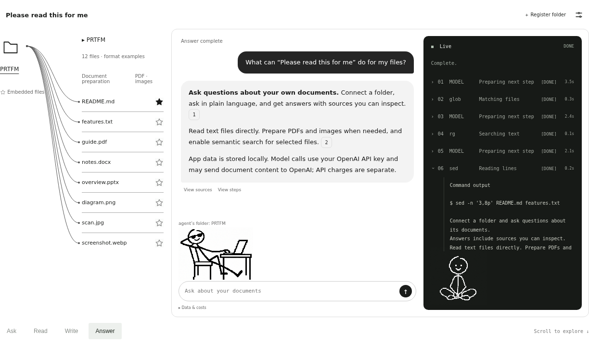
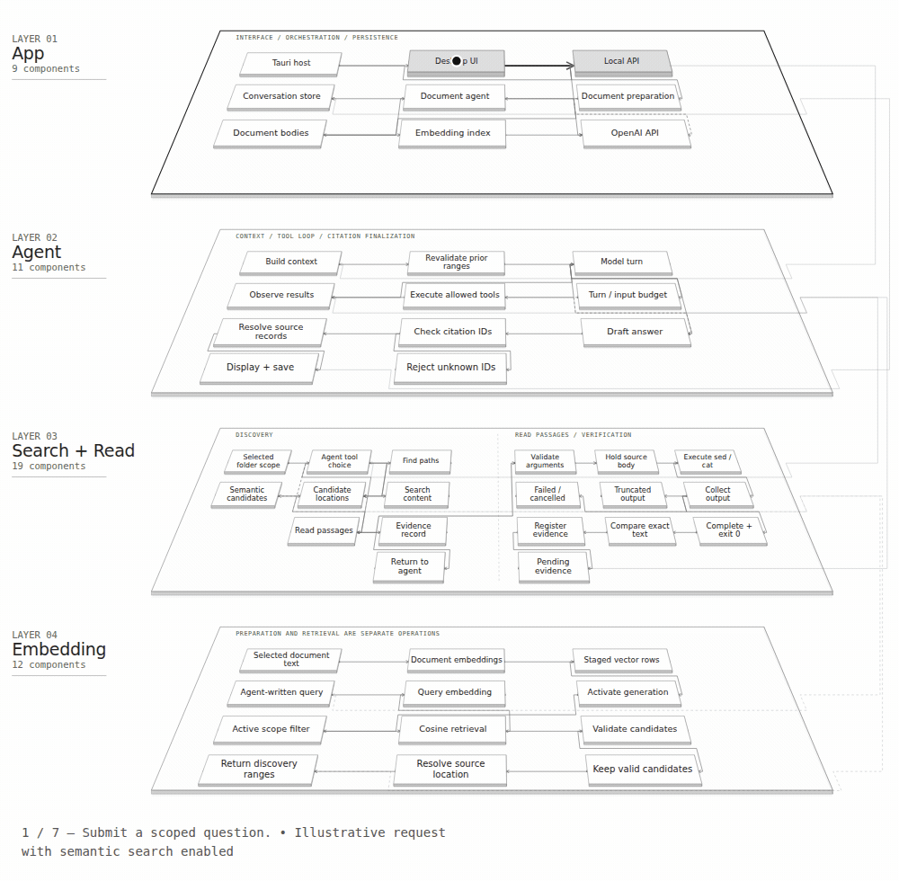
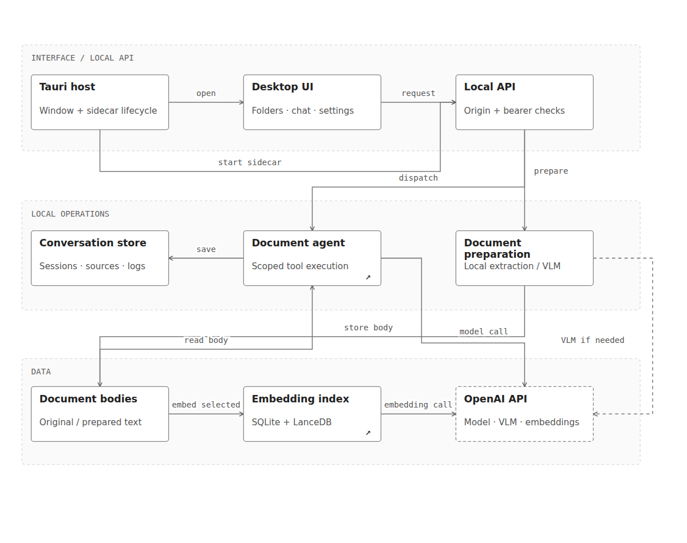
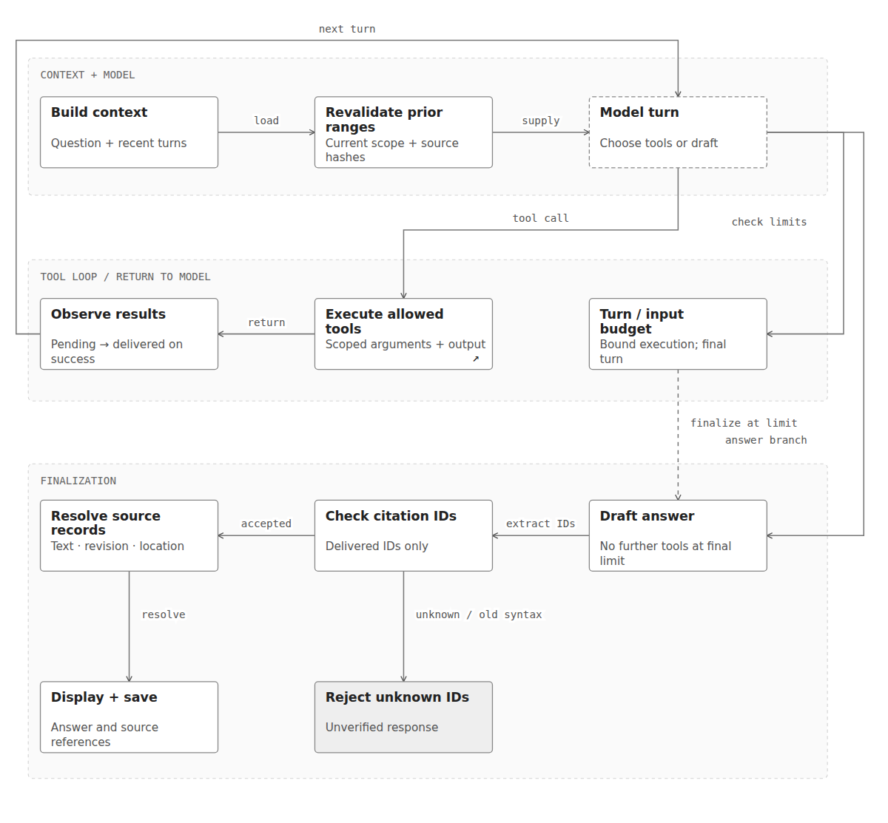
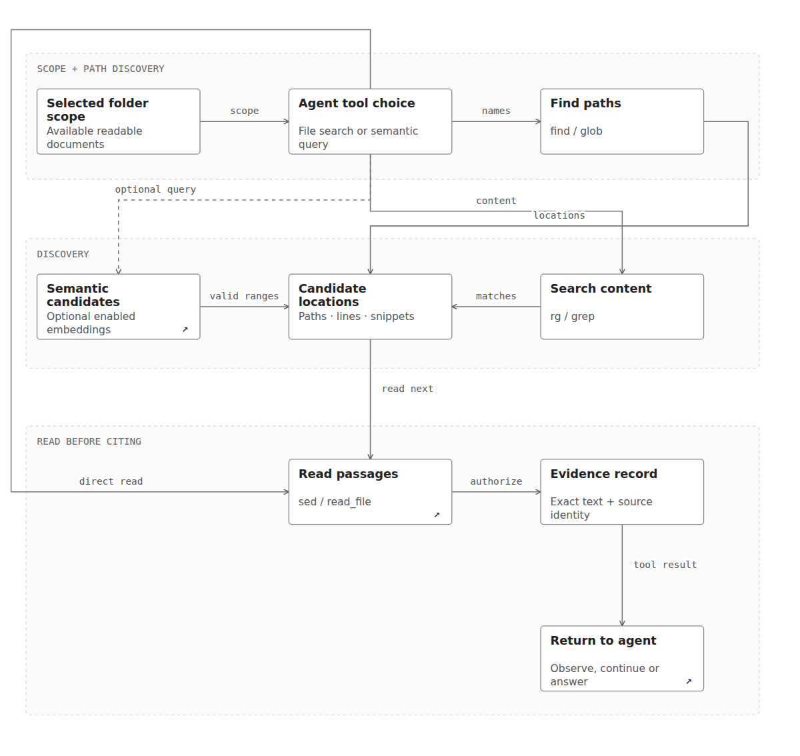
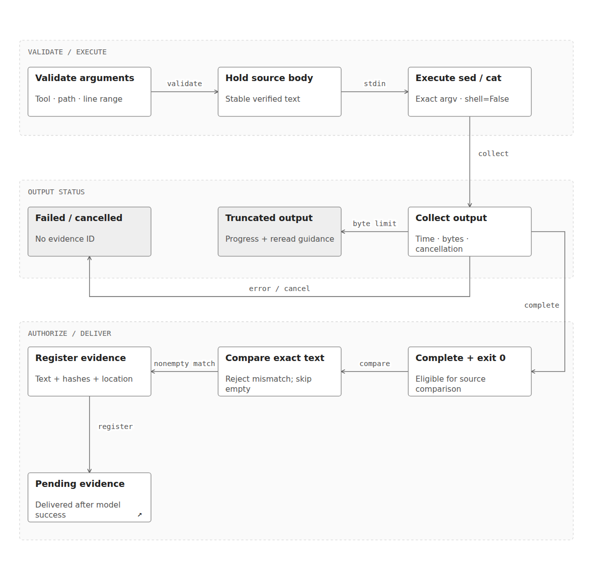
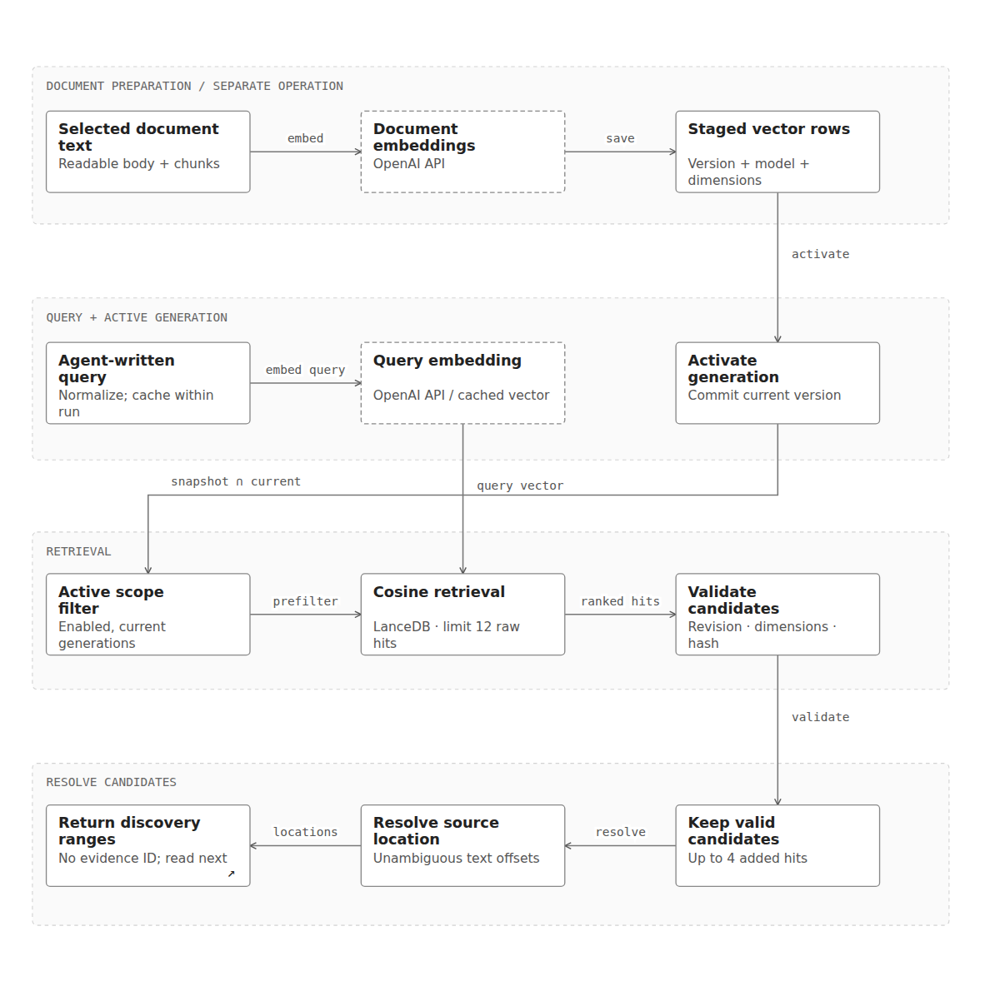

# Please read this for me

[English](README.md) · **한국어**

**Want me to read that?**

폴더 속 파일에 질문하고, 출처를 직접 확인할 수 있는 답변을 받아보세요.

Windows x64 설치형 Preview · 모델 호출에 OpenAI API 키 필요 · 선택적 의미 검색

[Windows 다운로드](https://github.com/pleasereadthisforme/pleasereadthisforme/releases) · [시작하기](#시작하기) · [사용 안내](#사용-안내) · [동작 방식](#동작-방식) · [데이터와 비용](#데이터와-비용) · [라이선스](#라이선스)

*가상 문서를 사용한 홍보 페이지 데모입니다. 웹사이트에 맞게 배치와 캐릭터 크기를 조정했으며 설치본 화면 캡처는 아닙니다.*

## 주요 기능

| 기능 | 설명 |
| --- | --- |
| 폴더 기반 질문 | 등록한 폴더를 선택하고 문서와 하위 폴더에 대해 질문합니다. |
| 에이전트 파일 탐색 | 파일을 찾고 텍스트를 검색하며 관련 본문을 읽습니다. 모든 파일을 임베딩할 필요는 없습니다. |
| 선택적 의미 검색 | 선택한 파일에 임베딩을 활성화합니다. 파일 탐색으로 근거가 부족하면 의미가 가까운 후보를 찾고 원문을 읽습니다. |
| 확인 가능한 답변 | 인용 근거를 열고 터미널에서 저장된 실행 단계를 확인합니다. |
| 문서 준비 | 로컬 텍스트를 추출하고 필요할 때 PDF·이미지 추가 준비 대상과 예상 API 비용을 검토합니다. |
| 로컬 데이터 관리 | 저장소 사용량을 확인하고 지원되는 앱 데이터, 폴더 연결, 대화를 정리합니다. |
| 원본 파일 열기 | 지원되는 원본 파일을 컴퓨터의 연결 프로그램으로 엽니다. |

### 파일 형식

아래는 현재 지원하는 전체 확장자와 처리 방식입니다.

| 종류 | 확장자 | 처리 방식 |
| --- | --- | --- |
| 텍스트 문서 | `.md`, `.markdown`, `.txt`, `.rst` | 파일 내용을 로컬에서 텍스트로 읽습니다. |
| Python | `.py` | 소스 텍스트를 읽습니다. 코드를 실행하지 않습니다. |
| JavaScript·TypeScript | `.js`, `.jsx`, `.ts`, `.tsx` | 소스 텍스트를 읽습니다. 코드를 실행하지 않습니다. |
| JVM 언어 | `.java`, `.kt` | 소스 텍스트를 읽습니다. 컴파일하거나 실행하지 않습니다. |
| 시스템·앱 언어 | `.go`, `.rs`, `.c`, `.h`, `.cpp`, `.hpp`, `.cs`, `.swift` | 소스·헤더 텍스트를 읽습니다. 코드를 실행하지 않습니다. |
| 스크립트·SQL | `.rb`, `.php`, `.sql`, `.sh`, `.ps1` | 파일 내용을 텍스트로 읽습니다. 스크립트·SQL을 실행하지 않습니다. |
| 구조화 데이터·설정 | `.json`, `.yaml`, `.yml`, `.toml`, `.xml`, `.ini`, `.cfg` | 파일 내용을 텍스트로 읽습니다. 설정을 적용하지 않습니다. |
| 웹 문서·스타일 | `.html`, `.css` | 마크업·스타일 소스를 텍스트로 읽습니다. 웹페이지를 렌더링하지 않습니다. |
| Word 문서 | `.docx` | `python-docx`로 본문 문단·제목·표 셀의 텍스트를 로컬 추출합니다. |
| PowerPoint 문서 | `.pptx` | `python-pptx`로 슬라이드 제목·텍스트 도형·표 셀의 텍스트를 로컬 추출합니다. |
| PDF | `.pdf` | `pypdfium2`로 로컬 텍스트를 추출합니다. 추가 문서 준비에서는 페이지를 분석하여 시각적 해석이 필요한 페이지를 이미지로 렌더링한 뒤 OpenAI **VLM(시각·언어 모델)**으로 처리합니다. |
| 이미지 | `.png`, `.jpg`, `.jpeg`, `.webp`, `.gif`, `.bmp`, `.tif`, `.tiff` | 문서 준비에서 `Pillow`로 이미지·프레임을 읽고 OpenAI **VLM**으로 글자·표·눈에 보이는 도형 정보를 추출합니다. |

## Preview 안내

- 대상은 **Windows x64**입니다. macOS·Linux 데스크톱·iOS 패키지는 제공하지 않습니다.
- 브라우저 화면은 로컬 개발·검증용이며 호스팅된 문서 읽기 서비스가 아닙니다.
- 현재 Preview 설치파일에는 코드 서명이 없습니다.
- 답변과 추출 결과에 오류나 빠진 내용이 있을 수 있으므로 근거 본문을 확인하세요.

홍보 사이트 소스는 별도의 [웹사이트 저장소](https://github.com/pleasereadthisforme/pleasereadthisforme.github.io)에서 관리합니다.

## 시작하기

[GitHub Releases](https://github.com/pleasereadthisforme/pleasereadthisforme/releases)에서 Windows x64 설치파일을 받으세요. 릴리스의 **Assets**에서 `_x64-setup.exe`로 끝나는 파일을 선택하면 됩니다. 소스 압축파일은 개발자용입니다.

1. Windows x64 설치파일로 설치하고 앱을 엽니다. 사용자가 실행파일을 빌드하거나 MSVC·Rust·Python·Java를 따로 설치할 필요는 없습니다.
2. 첫 실행에서 에이전트 이름을 정합니다. 이후 설정에서 변경할 수 있습니다.
3. **설정 → API 키**에서 별도의 네이티브 가림 입력창으로 OpenAI API 키를 등록합니다.
4. **＋ 폴더 등록**으로 폴더를 추가하고 질문 대상으로 선택합니다.
5. 질문을 입력합니다. 문서 준비나 임베딩을 사용할 때는 실행 전에 비용을 확인하세요.
6. 답변의 출처를 열어 근거를 확인합니다.

별도 앱 계정은 필요하지 않습니다. OpenAI API 키 발급·사용에는 제공자 계정과 API 이용 권한이 필요하며 API 비용은 별도입니다. 화면을 보는 데 키가 필요하지는 않지만 모델을 사용하는 요청에는 사용 가능한 키가 필요합니다.
메모리·여유 디스크 요구량과 패키지 크기는 빌드 및 작업량에 따라 달라집니다.

## 사용 안내

### 폴더와 질문

폴더 등록은 앱 목록에 폴더를 추가하는 동작입니다. 등록한 폴더를 선택하면 질문에 대해 에이전트가 살펴볼 범위가 정해집니다. 등록·선택만으로 문서 내용이 OpenAI에 전송되지는 않습니다.

질문 예시:

- “이 회의록의 결정 사항을 요약하고 출처를 보여줘.”
- “두 문서의 취소 조건을 비교해줘.”
- “그 답변을 일본어로 설명해줘.”

후속 질문에는 최근 대화 문맥을 사용합니다. 전체 대화 이력을 무제한으로 사용하는 것은 아니므로 대상이 모호하면 문서나 주제를 명시하세요.

### 문서 준비와 별표

**문서 준비**와 **의미 검색**은 서로 다른 기능입니다.

- 문서 준비는 필요한 PDF·이미지 추가 처리를 포함해 내용을 읽을 수 있도록 만듭니다.
- 파일의 **별표**는 선택적 임베딩·의미 검색을 제어합니다. 별표가 없는 파일도 일반 파일 탐색으로 찾고 읽을 수 있습니다.
- 실행 전에 대상·예상 비용·외부 전송 안내를 확인하세요. 견적은 최종 청구액 보장이 아닙니다.

### 답변·출처·터미널

출처를 누르면 저장된 근거 본문과 위치를 확인할 수 있습니다. 원본 텍스트 줄, 추출 본문 줄, PDF 페이지는 서로 다른 위치 정보이므로 표시된 구분을 확인하세요.

터미널은 실제 도구·모델 실행 이벤트와 제공 가능한 출력을 보여줍니다. 모델의 내부 사고 과정을 표시하지 않습니다. 완성된 답변을 보여주기 전에 인용 참조와 사용 가능한 근거를 대조하지만 모든 주장의 사실성을 보장하지는 않습니다.

원본 파일은 로컬 기본 프로그램으로 열립니다. 원본을 이동하거나 삭제하면 기존 경로로 열 수 없게 됩니다.

### 설정과 API 키

설정에서 언어·에이전트 이름·API 키·앱 저장소·백업을 관리합니다. 영어와 한국어를 지원하며, 처음에는 설치 시 선택한 언어를 사용합니다. **설정 → 언어**에서 변경하고 저장하면 즉시 적용됩니다. 문서 원문이나 답변을 번역하는 설정은 아닙니다. API 키 화면은 저장된 키 대신 등록 상태만 보여줍니다. 키 저장·삭제 후 변경 적용을 위해 앱이 재시작될 수 있습니다.

현재 OpenAI만 지원합니다. 키가 등록되어 있어도 유효성·잔액·모델 권한이 보장되는 것은 아닙니다. 인증 오류가 발생하면 설정에서 키를 확인하세요.

### 저장소·연결 해제·삭제

- **연결만 해제**는 앱 데이터를 남기고 연결을 해제합니다.
- **앱 데이터도 삭제**는 확인 후 지원되는 폴더 데이터와 연결을 제거합니다. 공유 데이터와 과거 출처 참조에 따라 삭제 범위가 달라질 수 있습니다.
- **전체 앱 저장소**에는 선택한 폴더뿐 아니라 연결 해제된 폴더와 공통·공유 데이터도 포함됩니다.
- 대화 삭제는 선택한 대화 또는 확인한 전체 대화 범위에 적용되며 원본 문서는 삭제하지 않습니다.
- 정확한 범위는 각 삭제 확인창에서 확인하세요. 원본 폴더와 별도 백업은 자동으로 삭제되지 않습니다.
- 앱 제거와 문서 저장소 삭제는 별개입니다.

### 이전 작업 확인

하단 패널에는 중단되거나 완료되지 않은 기록과 가능한 후속 동작이 표시됩니다. 관련 대화·폴더를 열거나 삭제 범위를 확인한 뒤 지원되는 미완료 기록을 정리할 수 있습니다. 요청을 자동 재전송하지 않습니다. 비용 미확정 기록은 환불이나 청구 확정을 의미하지 않습니다.

## 동작 방식

### 전체 시스템

준비된 문서에 질문하고 근거를 확인하는 설명용 재생입니다. 이 예시는 의미 검색을 포함하며, 모든 질문이 같은 경로를 실행하지는 않습니다. 문서 준비·임베딩 생성은 별도 작업입니다.

에이전트는 파일 탐색·선택적 의미 검색·본문 읽기를 반복합니다. 검색 후보는 본문을 읽고 검증한 뒤 인용할 수 있으며, 인용 참조 검사는 모든 주장의 사실 검증을 뜻하지 않습니다.

앱 구성

에이전트 파이프라인

검색 로직

본문 읽기와 근거 검증

임베딩 준비와 검색

## 데이터와 비용

- 처리 문서·임베딩·대화·실행 기록은 로컬 앱 저장소에 보관합니다. 로컬 저장이 모든 처리의 오프라인 실행을 뜻하지는 않습니다.
- 모델 호출 시 질문·최근 대화·검색하거나 읽은 문서 본문·경로가 OpenAI로 전송될 수 있습니다.
- PDF·이미지 추가 준비는 선택한 시각 자료를, 임베딩은 대상 텍스트를 전송할 수 있습니다.
- API 비용은 제공자가 청구합니다. 로컬 키 삭제는 OpenAI에서의 키 폐기가 아닙니다.
- Windows에서는 현재 사용자·앱 채널별로 Windows 자격 증명 관리자에 키를 저장합니다. 키는 네이티브 가림 입력창에서 입력하며 웹 화면에는 등록 상태만 전달합니다.
- 요청 중 키는 프로세스 메모리에서 사용하며 파서·검색 하위 프로세스의 환경변수로 전달하지 않습니다.
- 모델 요청은 `https://api.openai.com/v1`을 사용합니다. 현재 요청 정책은 임의 엔드포인트·리다이렉트·환경변수 기반 프록시 및 CA 재정의를 지원하지 않습니다.
- 앱 저장소에는 민감한 문서 본문이 포함될 수 있으며 앱 자체로 암호화하지 않습니다. 백업에도 같은 데이터가 포함될 수 있습니다.

이슈나 화면 캡처에 키·비공개 문서 내용을 포함하지 마세요.

## 저장소 범위

실행·빌드 소스, 필수 자산, 잠금 파일, 선택한 README와 허용된 스크린샷을 포함합니다. 개인 설계 기록·PoC·참고 영상·측정·개발 산출물은 `dev/` 아래에서 제외합니다. 기본 차단 방식의 `.gitignore`를 사용하므로 새 경로는 명시적으로 허용해야 Git 대상이 됩니다.

## 의견과 문제 신고

재현 가능한 문제는 [앱 Issues](https://github.com/pleasereadthisforme/pleasereadthisforme/issues)에 앱 버전·Windows 버전·재현 단계·예상 동작·실제 동작을 적어주세요. 키·문서 본문·개인을 식별할 수 있는 경로는 가려주세요.

## 라이선스

자체 앱 코드·모션 코드·필수 마스코트 이미지는 **GNU Affero General Public License v3.0 only(AGPL-3.0-only)**를 적용합니다. [LICENSE](LICENSE)와 [적용 범위](LICENSING.md)를 확인하세요. 해당 소스 제공 의무 등 라이선스 조건을 지키는 상업적 사용도 허용됩니다.

비공식 제품에 이름·로고·마스코트를 사용하면서 공식 승인을 받은 것처럼 표현해서는 안 됩니다. [브랜드 이용 안내](BRAND_USAGE.md)는 라이선스에서 허용한 복제·수정·상업적 재배포를 금지하지 않습니다.

제3자 구성요소는 각자의 라이선스를 유지합니다. Tauri에서 가져와 수정한 NSIS 템플릿에는 별도의 [MIT 라이선스](desktop/installer/LICENSE-MIT)와 [출처·변경 고지](desktop/installer/README.md)가 적용되며 앱 전체에 대한 라이선스는 아닙니다. 다른 구성요소는 의존성 메타데이터·빌드 manifest·동봉 고지도 확인하세요.

## 개인정보와 이용조건

[개인정보·저장소 안내(초안)](PRIVACY.md) · [Preview 이용조건(초안)](TERMS.md)

문의는 공개 GitHub Issues를 이용합니다. 운영자: ayaan. 배포 대상: 전 세계. 정책은 최초 공개 배포일부터 적용됩니다.
