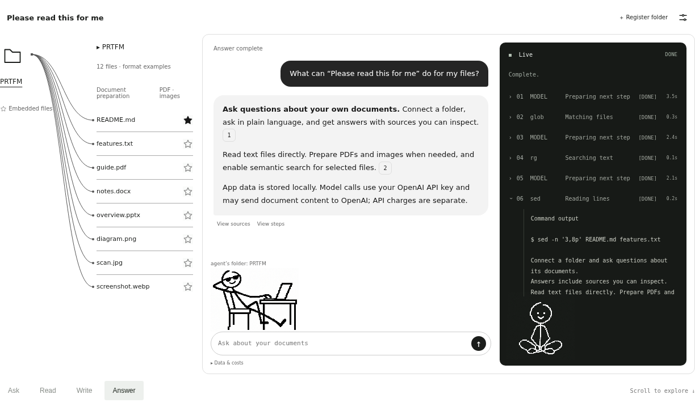
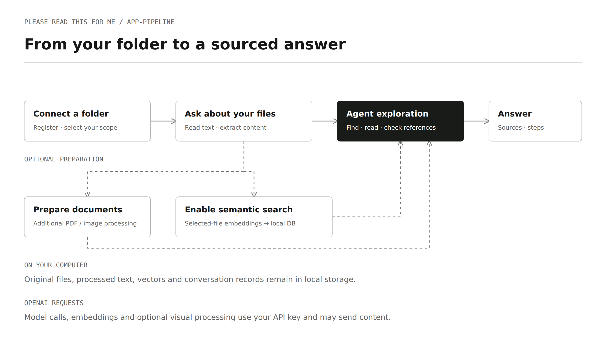
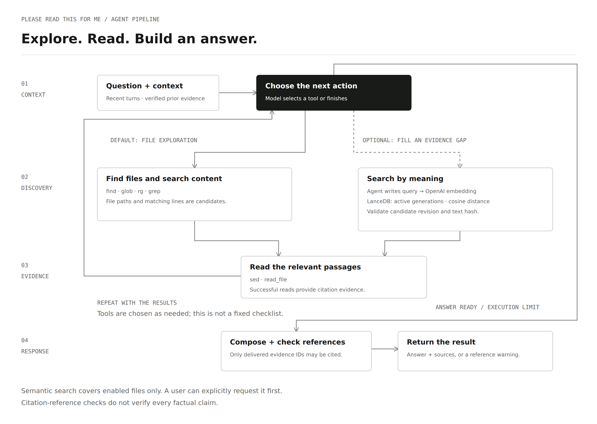

# Please read this for me

**English** · [한국어](README.ko.md)

**Want me to read that?**

Ask about files in your folders. Get answers with sources you can check.

Windows x64 desktop Preview · OpenAI API key required for model calls · Optional semantic search

[Download for Windows](https://github.com/pleasereadthisforme/pleasereadthisforme/releases) · [Getting started](#getting-started) · [User guide](#user-guide) · [How it works](#how-it-works) · [Data and costs](#data-and-costs) · [License](#license)

*Captured from the promotional demo using fictional documents. Some layout and character sizes are adapted for the website; this is not a screenshot of an installed release.*

## What it does

| Feature | What you can do |
| --- | --- |
| Folder-based questions | Select a registered folder and ask about its documents and subfolders. |
| Agentic file search | Let the agent locate files, search text and read relevant passages. Embedding every file is not required. |
| Optional semantic search | Enable embeddings for selected files. When file exploration leaves an evidence gap, the agent can look for meaning-based candidates and read their source passages. |
| Inspectable answers | Open cited evidence and inspect the recorded execution steps in the terminal. |
| Document preparation | Extract local text and, when needed, review additional PDF/image preparation and its estimated API cost. |
| Local data management | Review storage usage, delete supported app-data categories, and manage folder connections and conversations. |
| Original-file opening | Open supported original files with the computer's associated application. |

### File types

The following table lists all currently supported extensions and their processing paths.

| Content | Extensions | Processing |
| --- | --- | --- |
| Text documents | `.md`, `.markdown`, `.txt`, `.rst` | Read file contents locally as text. |
| Python | `.py` | Read source text without executing code. |
| JavaScript / TypeScript | `.js`, `.jsx`, `.ts`, `.tsx` | Read source text without executing code. |
| JVM languages | `.java`, `.kt` | Read source text without compiling or executing it. |
| Systems / application languages | `.go`, `.rs`, `.c`, `.h`, `.cpp`, `.hpp`, `.cs`, `.swift` | Read source and header text without executing code. |
| Scripts / SQL | `.rb`, `.php`, `.sql`, `.sh`, `.ps1` | Read file contents as text without executing scripts or SQL. |
| Structured data / configuration | `.json`, `.yaml`, `.yml`, `.toml`, `.xml`, `.ini`, `.cfg` | Read file contents as text without applying configuration. |
| Web documents / styles | `.html`, `.css` | Read markup and style source as text without rendering a web page. |
| Word documents | `.docx` | Extract body paragraphs, headings and table-cell text locally with `python-docx`. |
| PowerPoint documents | `.pptx` | Extract slide titles, text-bearing shapes and table-cell text locally with `python-pptx`. |
| PDF | `.pdf` | Extract text locally with `pypdfium2`. Additional document preparation analyzes pages and renders those needing visual interpretation for processing by an OpenAI **vision-language model (VLM)**. |
| Images | `.png`, `.jpg`, `.jpeg`, `.webp`, `.gif`, `.bmp`, `.tif`, `.tiff` | During document preparation, read images / frames with `Pillow` and use an OpenAI **VLM** to extract text, tables and visible figure information. |

## Preview status

- Target: **Windows x64**. macOS, Linux desktop and iOS packages are not provided.
- The browser UI is for local development and verification, not a hosted document-reading service.
- Current Preview packaging is unsigned.
- Answers and extracted content can be incomplete or wrong. Inspect the supporting passages before relying on an answer.

The promotional website source is maintained in the separate
[website repository](https://github.com/pleasereadthisforme/pleasereadthisforme.github.io).

## Getting started

Download the Windows x64 installer from [GitHub Releases](https://github.com/pleasereadthisforme/pleasereadthisforme/releases). In the release’s **Assets**, choose the file ending in `_x64-setup.exe`; the source archives are for developers.

1. Install the Windows x64 package and open the app. End users do not compile the executable or install MSVC, Rust, Python or Java.
2. Choose an agent name on first launch; change it later in Settings.
3. Open **Settings → API key** and register an OpenAI API key in the separate masked native input window.
4. Use **＋ Register folder** to register a folder, then select it as the question scope.
5. Ask a question. Review document-preparation or embedding costs before starting those optional operations.
6. Open the answer's sources to inspect its supporting passages.

There is no separate app-account registration. OpenAI account/API access is needed to obtain and use your own key; API charges are separate.
The key is not required simply to view the interface, but model-dependent requests cannot succeed without a usable key.
Exact minimum RAM, free-disk requirements and package size depend on the released build and workload; this README does not claim an independently validated minimum.

## User guide

### Folders and questions

Registering a folder adds it to the app's list. Selecting a registered folder determines what the agent may examine for the question. Registering or selecting a folder alone does not send its document contents to OpenAI.

Ask specific questions, for example:

- “Summarize the decisions in these meeting notes and show the sources.”
- “Compare the cancellation conditions in these two documents.”
- “Explain that answer in Japanese.”

Follow-up questions use recent conversation context, not unlimited chat history. If a reference is ambiguous, name the document or subject explicitly.

### Document preparation and the star

**Document preparation** and **semantic search** are different operations.

- Preparation makes content available for reading, including additional PDF/image processing when requested.
- The file's **star** controls optional embedding/meaning-based search. An unstarred file may still be found and read through ordinary file exploration.
- Review the target files, estimated cost and external-transfer notice before proceeding. An estimate is not a guaranteed final charge.

### Answers, sources and the terminal

Source controls reveal saved supporting passages and their locations. Text-source lines, extracted-content lines and PDF pages are different location types; read the labels shown in the app.

The terminal shows recorded tool/model execution events and available outputs, not private model reasoning. Source references are checked against available evidence before a completed answer is shown; this does not prove every claim is correct.

Original-file opening uses the local default application. Moving or deleting an original can make its previous path unavailable.

### Settings and API keys

Settings provides language, agent-name, API-key, app-storage and backup controls.
The app supports English and Korean. The installer language sets the initial UI language; change it in **Settings → Language** and save to apply it immediately. Document contents and answers are not translated by this setting.
Key management shows registration status, not the stored secret. Saving or deleting a key can restart the app to apply the change.

Only OpenAI is currently supported. Key presence is not proof that it is valid, funded or authorized for the requested model. If authentication fails, review the key in Settings.

### Storage, disconnection and deletion

- **Disconnect only** removes the connection while retaining associated app data.
- **Delete app data as well** removes the supported folder data and connection after confirmation. Shared data and historical source references can affect what can be removed.
- **Whole app storage** reports more than the currently selected folder: disconnected-folder data and common/shared data can remain.
- Conversation deletion removes the selected conversation or the confirmed conversation collection. It does not delete original documents.
- Review each deletion dialog for the exact scope. Deleting app data does not delete the original folder; separate backups are not automatically erased.
- Uninstalling the app and deleting its document storage are separate operations.

### Previous work

The lower-panel “previous work” view shows interrupted or incomplete records and available follow-up actions. Open the associated conversation/folder or remove supported incomplete records after reviewing the confirmation. Requests are not automatically resent. An uncertain cost record is not proof of a refund or a finalized charge.

## How it works

### Application pipeline

Document preparation and selected-file embedding are optional. Model requests use your API key.

[HTML source](readme-assets/diagrams/app-pipeline.html)

### Agent pipeline

The agent chooses file exploration, optional semantic search and source reading in a bounded loop. File exploration comes first by default; semantic candidates must be read before citation. Citation-reference checks do not verify every factual claim.

[HTML source](readme-assets/diagrams/agent-pipeline-v4.html)

## Data and costs

- Processed documents, embeddings, conversations and execution records are stored in the local app-data directory. Local storage does **not** mean all processing is offline.
- Questions, recent conversation context, searched/read document content and paths may be sent to OpenAI during model calls.
- Additional PDF/image preparation can send selected visual content. Embedding sends the text being embedded.
- API usage is charged by the provider. Removing a local key does not revoke it at OpenAI.
- The Windows host stores keys in Windows Credential Manager for the current user and app channel. Secret entry remains in a masked native dialog; the web UI receives status, not the key.
- Keys are used in process memory for requests and are not passed in parser/search child-process environments.
- Model requests use `https://api.openai.com/v1`; custom endpoints, redirects and environment-proxy/CA overrides are not supported by the current request policy.
- App storage may contain sensitive document text and is not encrypted by the app. Backups may contain the same data.

Never include keys or private document contents in an issue or screenshot.

## Repository scope

The repository includes runtime/build source, required assets, lockfiles, selected READMEs and the explicitly allowed screenshots.
Personal design notes, PoCs, reference media, measurements and development artifacts remain excluded under `dev/`.
The default-deny `.gitignore` requires an explicit decision before new paths become eligible for Git.

## Feedback

Use the [application issue tracker](https://github.com/pleasereadthisforme/pleasereadthisforme/issues) for reproducible reports. Include the app version, Windows version, steps, expected behavior and actual result. Redact keys, document text and identifying paths.

## License

The project's own application code, motion code and required mascot images are licensed under the **GNU Affero General Public License v3.0 only (AGPL-3.0-only)**. See [LICENSE](LICENSE) and the [licensing scope](LICENSING.md). Commercial use is permitted subject to the license, including applicable source-sharing obligations.

Names, logos and mascots must not be presented as evidence of official endorsement of an unofficial product. See [brand usage](BRAND_USAGE.md). This guidance does not prohibit the copying, modification or commercial redistribution permitted by the license.

Third-party components retain their respective licenses. In particular, the bundled NSIS template is adapted from Tauri and carries its own [MIT license](desktop/installer/LICENSE-MIT) and [attribution/change notes](desktop/installer/README.md). That notice does not license the entire application. Dependency metadata and build manifests identify additional components; this section is not a complete third-party notice inventory.

## Privacy and use conditions

[Privacy and storage (draft)](PRIVACY.md) · [Preview use conditions (draft)](TERMS.md)

Support is provided through public GitHub Issues. Operator: ayaan. Distribution: worldwide. Policies take effect on the first public release date.
